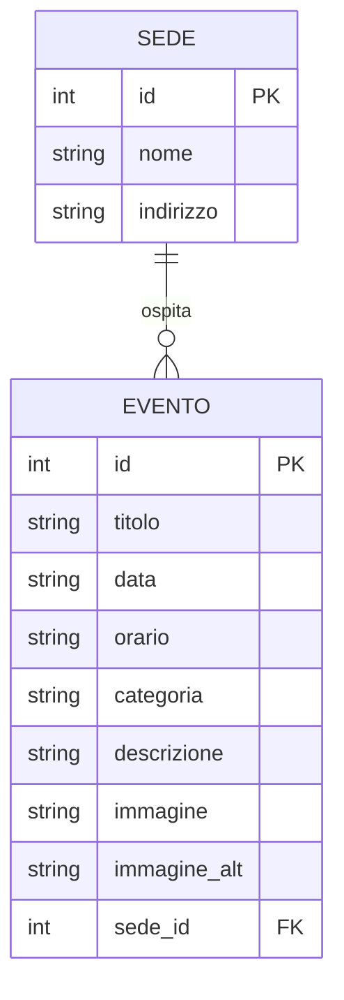

# Scheda dati — Segnale

Il Programma del sito è generato da due file JSON: `eventi.json` e `sedi.json`.

## 1. Entità

- **Evento**: un appuntamento del festival (per esempio «Lettere in movimento»).
- **Sede**: un luogo in cui si svolgono gli eventi (per esempio «Officina Nord — Sede centrale»).

## 2. Campi

### Sede

| Campo | Tipo | Esempio |
| --- | --- | --- |
| id | numero | 1 |
| nome | testo | Officina Nord — Sede centrale |
| indirizzo | testo | Corso Duca degli Abruzzi 24, Torino |

### Evento

| Campo | Tipo | Esempio |
| --- | --- | --- |
| id | numero | 1 |
| titolo | testo | Lettere in movimento |
| data | testo (AAAA-MM-GG) | 2026-06-12 |
| orario | testo | 10:00 |
| categoria | testo | Incontro |
| descrizione | testo | Come cambia un messaggio quando cambiano le lettere? Un incontro su tipografia, ritmo e comunicazione visiva. |
| immagine | testo (percorso del file) | assets/lettere-in-movimento.svg |
| immagine_alt | testo | Lettere geometriche disposte su una griglia |
| sede_id | numero (riferimento alla sede) | 1 |

## 3. Chiavi

- **Chiave primaria**: `id` in entrambe le entità. È un numero, univoco nell'entità e stabile: non cambia anche se un evento o una sede viene modificato.
- **Chiave esterna**: `sede_id`, dentro Evento, contiene l'`id` della sede.

## 4. Relazione

Una sede può ospitare più eventi; ogni evento si svolge in una sede. `Evento.sede_id` fa riferimento a `Sede.id`.

## 5. Quantità

Sei eventi e tre sedi.

## 6. Chi aggiorna i dati e come

Chi cura il sito modifica i file `dati/eventi.json` e `dati/sedi.json` nella repository e pubblica le modifiche con commit e push; GitHub Pages aggiorna il sito.

## 7. Che cosa mostra la pagina

La pagina Programma mostra una scheda per ogni evento, con titolo, immagine, giorno, orario, categoria, descrizione e il nome della sede, preso da `sedi.json` tramite `sede_id`. Se i dati stanno caricando, non ci sono eventi o un file non si legge, mostra un messaggio. Se la sede di un evento non esiste, l'evento compare con «Sede da definire».